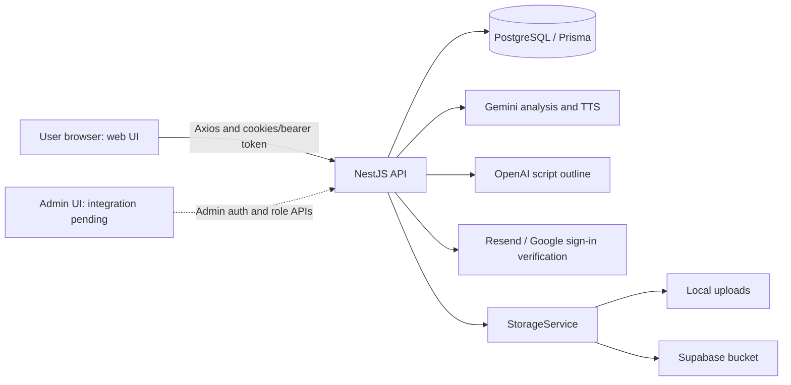

# AutoCanvas: project map

## Pehle ye samjhein

Teen independent repositories hain; each has its own dependencies, commands and Git history. Current source does not require a monorepo workspace or a separate Redis/BullMQ worker for the implemented audio jobs.

| Repository | Responsibility | Local port |
| --- | --- | --- |
| `autocanvas-web` | User UI, browser session state, API clients, Audio Studio and animation editor. | 3000 |
| `autocanvas-api` | Authentication/permissions, PostgreSQL data, background audio/analysis work, storage and exports. | 4000 by default; backend PORT can override. |
| `autocanvas-admin` | Admin UI project; currently a placeholder page and theme switcher. | 3001 |

The browser calls the API directly for the current audio/animation flows. Do not use comments in older server-action bridge code as proof that a route, queue or provider is active.

## Ownership boundaries

| Area | Frontend entry point | Backend owner |
| --- | --- | --- |
| Login, registration, OTP, Google sign-in | `src/providers/AuthProvider.tsx`, `src/app/api/auth/` | `src/auth/` |
| Story create/edit/analyze, cast assignment | `src/app/(app)/audio/`, `src/app/api/audio-studio/` | `src/audio-stories/` |
| Multi-scene generation, retry, cancellation, history | `audio/audio-generation/` components | `src/audio-generation/audio-generation.service.ts` |
| Single narration | `audio/single-voice-studio.tsx` | `src/audio-generation/single-voice.service.ts` |
| Voices and provider usage | Voices API client and cast UI | `src/voices/`, `src/ai/usage/`, TTS providers |
| Playback, ZIP and combined WAV | Audio clients and players | Audio-generation controllers + `src/storage/` |
| Animation projects/scenes | `src/app/(workspace)/animation/`, `src/app/api/animation/` | `src/animation/` |
| Admin/superadmin permissions and role changes | Admin integration still pending | `src/auth/`, documented in backend `docs/admin-auth.md` |

## Source map

Frontend:

- `src/app/(auth)/`: auth-related screens. A screen existing does not by itself prove its backend flow is connected.
- `src/app/(app)/`: shell-based user screens.
- `src/app/(workspace)/`: full-height workspace/editor screens.
- `src/app/api/axios.ts`: API base URL, bearer token and refresh/retry handling.
- `src/components/layout/`: shared header/sidebar/shell.
- `src/lib/dummy-data.ts`: demo state; the shell's displayed credits/plan still come from here.

Backend (paths are in `autocanvas-api`):

- `src/main.ts`: HTTP startup, validation, CORS, cookies, Swagger and local static assets.
- `src/app.module.ts`: module registration.
- `src/prisma/prisma.service.ts`, `prisma/schema.prisma`: database access/schema.
- `src/auth/`: shared auth/session logic plus isolated role-management logic.
- `src/audio-stories/`, `src/audio-generation/`: persisted analysis/generation workflows.
- `src/storage/storage.service.ts`: provider selection and stored-location parsing.

## Implemented versus pending

Implemented: PostgreSQL-backed sessions/analysis jobs, multi-scene generation jobs, single-voice flow, cancellation, readable per-scene downloads, local/Supabase adapters, admin/superadmin backend permissions and audit.

Pending or incomplete:

- Admin frontend login/session/role-management screens.
- The agreed story-name/voice-type/job folder reorganization and title-based ZIP naming. Current storage layout remains ID/UUID based; see backend `docs/storage.md`.
- Additional storage providers: the interface mentions `r2`, but StorageService currently registers only local and Supabase.
- A number of product screens, credits and plan values still use demo data. They are not evidence of production billing/enforcement.
- `src/lib/backend-client.ts` contains an incomplete older bridge. Current Audio Studio integration is in `src/app/api/audio-studio/`.

## Change rules

Reuse the current API clients, services, guards and storage adapter instead of adding parallel systems. Enforce permissions/ownership on the backend; frontend route hiding is UX only. Keep analysis jobs distinct from audio jobs. Treat provider IDs/storage paths as persisted data, not strings to rebuild from a title. Coordinate DTO, response type, UI and docs changes when an API contract changes.

For local commands and debugging, read [development.md](development.md). For UI responsibilities, read [frontend-guide.md](frontend-guide.md).
